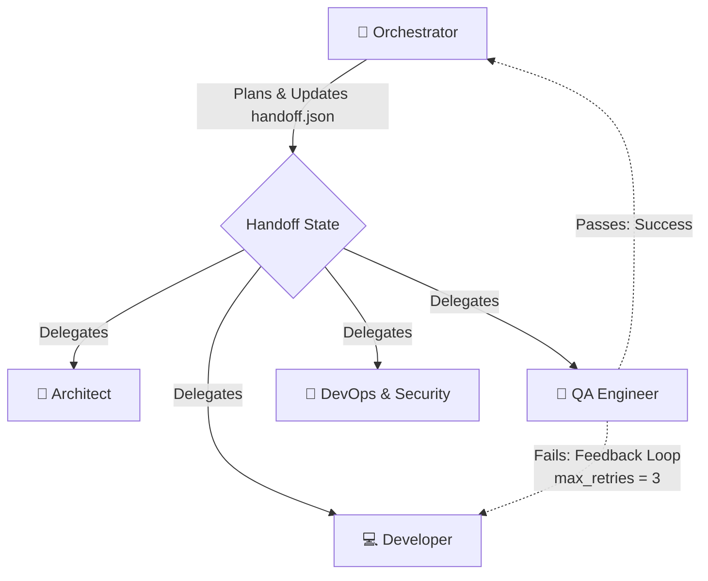

# 🤖 Universal Multi-Agent Kit (v5.1 Ultimate)

[]()
[]()
[]()

A production-ready, language-agnostic framework designed to turn any AI CLI (like Claude Code, Cursor Composer, or terminal agents) into a structured, autonomous software engineering team. 

This kit eliminates common LLM agent issues such as context window bloat, hallucinations, and infinite loops by strictly enforcing **Role Segregation (SRP)** and a **Typed JSON Handoff Protocol**.

## ✨ Key Features

- **Strict Separation of Concerns (SRP):** Agents are confined to their specific roles. The Developer writes code but *never* writes tests. The QA Engineer writes tests but *never* modifies business logic.
- **Zero-Chat Delegation:** Agents do not communicate via unstructured plain text. All task delegations and context handoffs occur through a strictly typed `agent/.state/handoff.json` file.
- **Anti-Looping Mechanism:** A built-in feedback loop between QA and Developer is capped at a maximum of 3 retries (`max_retries`). If tests continue to fail, the task is marked as `BLOCKED` for human intervention, preventing infinite token-burning loops.
- **Universal & Language-Agnostic:** Works seamlessly with Go, Python, React, Rust, Node.js, and any other tech stack.
- **Deterministic TDD:** Forces the creation of unit and integration tests *before* checklist items can be ticked.

## 🏗️ System Architecture

The kit utilizes a **Supervisor-Worker** architecture. The Orchestrator manages the DAG (Directed Acyclic Graph) of tasks and delegates them to specialized workers.



## 📂 Directory Structure

```text
.
├── AGENTS.md                 # System entry point for all agents
├── BOOTSTRAP.md              # Initialization prompt for new projects
└── agent/
    ├── HANDOFF_SCHEMA.md     # Strict JSON schema for agent communication
    ├── RUNBOOK.md            # Comprehensive human operator manual
    ├── STATE.md              # Global execution state & block logs
    ├── .state/
    │   └── handoff.json      # The single source of truth for agent turns
    ├── rules/                # Non-negotiable engineering rules (00 to 10)
    ├── roles/                # Isolated agent personas (Orchestrator, Dev, QA, etc.)
    ├── skills/               # Reusable engineering procedures (Token-budget, debugging, etc.)
    ├── masters/              # Domain-driven planning prompts & EXECUTE engine
    ├── Milestones/           # Output directory for actionable task breakdowns
    └── tools/                # CLI tools (NEW-FEATURE, QUICK-TASK)
```

## 🚀 Quick Start

1. **Install the Kit:** Copy the `AGENTS.md`, `BOOTSTRAP.md`, and the `agent/` directory into the root of your repository.
2. **Initialize Workspace:** Open your AI CLI and run:
   ```bash
   Read BOOTSTRAP.md and follow it exactly.
   ```
3. **Plan a Feature:** Turn your idea into actionable milestones:
   ```bash
   Read AGENTS.md, then read agent/tools/NEW-FEATURE.md and follow it exactly.
   Feature request: Add JWT Authentication.
   ```

## 💻 Execution Commands

Use these commands in your AI CLI to drive the engineering team. (See `agent/MULTI_AGENT_COMMANDS.md` for the full list).

### Option A: Autonomous Mode
Let the Orchestrator autonomously cycle through the Architect, Developer, and QA roles until the milestone is complete or blocked:
```bash
Read AGENTS.md, then agent/masters/EXECUTE.md and follow it exactly.
MODE: FULLY AUTONOMOUS MULTI-AGENT EXECUTION.
```

### Option B: Step-by-Step Mode (Maximum Control)
Trigger the orchestrator to prepare the next step:
```bash
Read AGENTS.md, then agent/roles/00-orchestrator.md and agent/masters/EXECUTE.md.
Task: Inspect active milestone, prepare next step in agent/.state/handoff.json, and state which role is needed next.
```
Then, manually invoke the designated worker (e.g., Developer):
```bash
Read AGENTS.md, then agent/roles/02-developer.md and agent/.state/handoff.json.
Execute your coding task. DO NOT write tests. Update handoff.json when complete.
```

## 🛡️ Core Safety Rules

- The `agent/` directory is isolated tooling and must NEVER be compiled into production artifacts.
- Destructive operations (`rm -rf`, `DROP TABLE`, `git push --force`) are strictly prohibited autonomously and require a `BLOCKED-ON-HUMAN` manual execution.
- No secrets or credentials shall ever be committed; agents must use `.env.example` placeholders.

---
*Built for the next generation of autonomous AI software development.*
