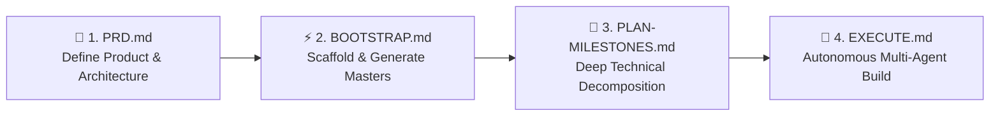
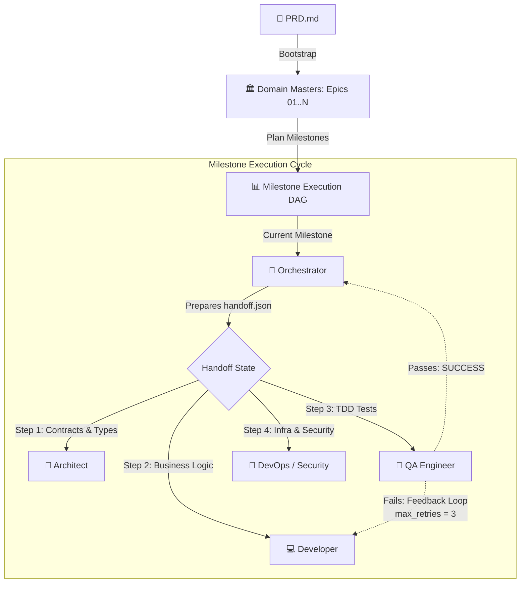

# 🤖 Universal MultiAgent-Kit (v6.0 Production-Ready)

[]()
[]()
[]()
[]()

A battle-tested, language-agnostic multi-agent engineering framework designed to transform any AI CLI or IDE assistant (such as Google Antigravity, Claude Code, Cursor Composer, or terminal LLM agents) into a disciplined, high-velocity autonomous software engineering team.

MultiAgent-Kit v6.0 eliminates the core failure modes of autonomous coding agents—hallucinations, context window overflow, cosmetic test tampering, and infinite debugging loops—through a deterministic **PRD-Driven Lifecycle**, **Strict Single Responsibility Principle (SRP)**, a **Go-Native Typed Handoff Protocol**, and **Unlimited Hierarchical Epic-to-Milestone Decomposition**.

---

## 🧭 The End-to-End 4-Step Lifecycle



1. **Step 1: Requirements in `PRD.md`**  
   Capture the product vision, preferred tech stack, architecture guidelines, and feature domains in the root `PRD.md` specification file.
2. **Step 2: Workspace Bootstrap & Master Generation (`BOOTSTRAP.md`)**  
   Run `Read BOOTSTRAP.md and follow it exactly.` The agent ingests `PRD.md`, scouts the repository, generates `agent/info/PROJECT_MAP.md`, and creates **Domain Masters (`agent/masters/NN-*.md`) with ZERO limits on quantity**.
3. **Step 3: Deep Technical Milestone Decomposition (`PLAN-MILESTONES.md`)**  
   Run `Read AGENTS.md, then read agent/tools/PLAN-MILESTONES.md and follow it exactly.` The Architect decomposes every Master into multiple granular, independently testable Milestones (`agent/Milestones/NN-MM-*.md`) with exhaustive technical contracts, negative scenarios, edge cases, and TDD matrices. **There is NO limit on the number of milestones.**
4. **Step 4: Autonomous Product Development (`EXECUTE.md`)**  
   Run `Read AGENTS.md, then agent/masters/EXECUTE.md and follow it exactly. MODE: FULLY AUTONOMOUS MULTI-AGENT EXECUTION.` The Orchestrator supervises worker roles or subagents, executing code, writing tests, verifying baselines, and committing atomically until the entire product is built.

---

## ✨ Key Capabilities & Architectural Innovations

- **PRD-First Dynamic Scaffolding:** Software development begins with a structured specification document (`PRD.md`). The bootstrap process automatically transforms each feature domain into an architectural Epic Master.
- **Unlimited Hierarchical Decomposition (1:N:M):**
  - **Masters (`agent/masters/NN-*.md`):** Macro-architectural blueprints (Epics) defining subsystem boundaries, contract shifts, and high-level milestones.
  - **Milestones (`agent/Milestones/NN-MM-*.md`):** Granular units of delivery ($\le 5$ files, 1-2 hours). Every milestone contains concrete types, interfaces, DTOs, database DDLs, status codes, negative paths, concurrency locks, and an explicit TDD verification matrix.
- **Pure Go-Native Tooling (`agent/tools/mak`):** All kit tooling is compiled into a lightweight, high-performance native Go binary with **zero Python dependencies**. Features subcommands for fast validation (`mak validate`), deep audits (`mak check-all`), execution dashboards (`mak summary`), and milestone progress bars (`mak stats`).
- **Strict Separation of Concerns (SRP):**
  - **Architect:** Designs interfaces, contracts, and database DDL. Never writes implementation or tests.
  - **Developer:** Implements business logic strictly fulfilling contracts. **NEVER writes tests.** Fixes bugs reported by QA.
  - **QA Engineer:** Writes comprehensive unit, integration, and failure-injection tests. **NEVER touches application code.**
  - **Security Reviewer:** Audits code against OWASP Top 10, sanitization, and secrets leakage.
  - **DevOps Engineer:** Configures Docker, CI/CD pipelines, and environment isolation.
  - **Orchestrator:** Coordinates DAG transitions, manages typed JSON state, and performs atomic git commits.
- **Anti-Looping Circuit Breaker:** The feedback loop between QA and Developer is capped at 3 retries (`max_retries = 3`). If tests still fail, the system transitions to `BLOCKED` and halts safely, preventing infinite token burnout.
- **Battle-Tested Skills Catalog:** 15 modular procedures (4 `always` procedures for token budgeting & checkpointing, and 11 `on-demand` procedures covering root-cause debugging, zero-downtime DB migrations, security threat modeling, etc.).

---

## 🏗️ Multi-Agent Execution Flow



---

## 📂 Directory Layout

```text
.
├── AGENTS.md                 # System entry point for all agents
├── BOOTSTRAP.md              # Workspace initializer & Master generator (PRD-driven)
├── PRD.md                    # Product Requirements Document (idea & specifications)
├── Makefile                  # Build, test, validate, summary, stats targets
└── agent/
    ├── HANDOFF_SCHEMA.md     # Strict JSON schema for agent communication
    ├── KIT.md                # Kit v6.0 architectural specification
    ├── MULTI_AGENT_COMMANDS.md# Copy-paste terminal commands for all workflows
    ├── RUNBOOK.md            # Operator manual & system management guide
    ├── STATE.md              # Global execution state & quick tasks log
    ├── .state/
    │   └── handoff.json      # Single source of truth for agent transitions
    ├── rules/                # Non-negotiable engineering rules (00 to 10)
    ├── roles/                # Isolated agent personas (Orchestrator, Dev, QA, etc.)
    ├── skills/               # 15 actionable engineering procedures (always & on-demand)
    ├── masters/              # Domain-driven epic architectural blueprints (01-*.md)
    ├── Milestones/           # Granular, actionable milestone files (NN-MM-*.md) & INDEX
    └── tools/
        ├── mak               # Compiled Go-native CLI & validator binary
        ├── validate_state    # Symlink / binary alias for backward compatibility
        ├── PLAN-MILESTONES.md# Deep technical milestone decomposition engine
        ├── NEW-FEATURE.md    # Post-bootstrap domain feature planner
        ├── QUICK-TASK.md     # Micro-fixes & hotfix protocol (< 3 files)
        └── validator/        # Go source code & unit tests (main.go, main_test.go)
```

---

## 🚀 Quick Start Guide

### 1. Define Your Idea in `PRD.md`
Fill in `PRD.md` at your repository root with your product idea, tech stack preferences, and feature domains (or run `./agent/tools/mak init-prd` to create a template).

### 2. Bootstrap Workspace & Generate Masters
In your AI assistant terminal or chat, run:
```bash
Read BOOTSTRAP.md and follow it exactly.
```
*Output: Scaffolds the workspace, maps the project, and generates Domain Masters (`agent/masters/01-*.md`, etc.) for every feature domain in your PRD.*

### 3. Decompose Masters into Granular Milestones
Run:
```bash
Read AGENTS.md, then read agent/tools/PLAN-MILESTONES.md and follow it exactly.
```
*Output: Decomposes each Master into granular, production-ready Milestones (`agent/Milestones/NN-MM-*.md`) with deep technical contracts, negative scenarios, and TDD verification matrices.*

### 4. Start Autonomous Product Development
Run:
```bash
Read AGENTS.md, then agent/masters/EXECUTE.md and follow it exactly.
MODE: FULLY AUTONOMOUS MULTI-AGENT EXECUTION.
```
*Output: The Orchestrator autonomously dispatches workers/subagents through the Supervisor-Worker cycle until the entire product is implemented, tested, and committed.*

---

## 🛠️ Go-Native CLI Reference (`agent/tools/mak`)

MultiAgent-Kit features a unified, zero-dependency Go CLI tool:

```bash
# Fast state validation (handoff.json & STATE.md)
./agent/tools/mak validate

# Full system integrity audit (rules, roles, skills, templates, PRD, state)
./agent/tools/mak check-all

# Visual execution dashboard
./agent/tools/mak summary

# Milestone execution metrics & progress bar
./agent/tools/mak stats

# Synchronize timestamps in state files
./agent/tools/mak touch

# Safely reset QA retry counter and unblock
./agent/tools/mak reset-retry

# Initialize default PRD.md template
./agent/tools/mak init-prd

# Run via Make:
make stats
make summary
make validate-all
make reset-retry
```

---

## 🛡️ Core Safety Principles

- The `agent/` directory is isolated engineering tooling and must **NEVER** be imported into production application bundles or Docker runtime images.
- Destructive commands (`rm -rf`, `DROP TABLE`, `git push --force`) are strictly prohibited autonomously and require human authorization.
- Zero secrets leakage: API keys, tokens, and passwords must never be committed; use `.env.example` placeholders.
- Non-regression guarantee: Passed test count must always be $\ge$ baseline count with 0 new failures.

---
*MultiAgent-Kit v6.0 — Engineered for deterministic, reliable, and autonomous AI software engineering.*
