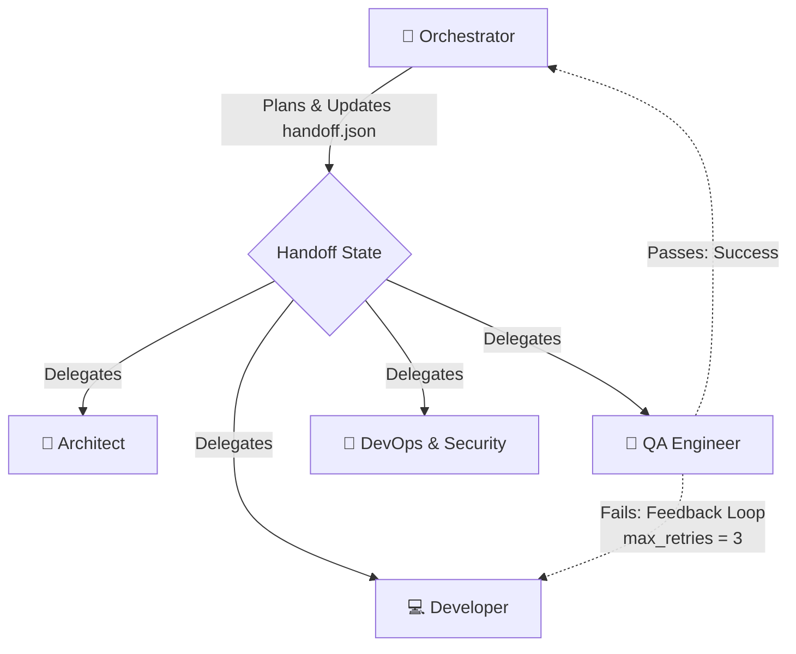

# 🤖 Universal Multi-Agent Kit (v5.2 Production-Ready)

[]()
[]()
[]()

A battle-tested, language-agnostic engineering framework designed to turn any AI CLI or IDE agent (such as Antigravity, Claude Code, Cursor Composer, or terminal agents) into a structured, autonomous software engineering team.

This kit eliminates common LLM agent issues such as context window bloat, hallucinations, and infinite debugging loops by strictly enforcing **Role Segregation (SRP)**, a **Typed JSON Handoff Protocol**, and **Automated State Validation**.

## ✨ Key Capabilities & Features

- **Strict Separation of Concerns (SRP):** Agents are confined to isolated roles. The Developer implements business logic but *never* writes tests. The QA Engineer writes tests and failure-injection suites but *never* modifies application logic.
- **Automated State Validation CLI (`validate_state.py`):** Deterministic Python validator checks `agent/.state/handoff.json` and `agent/STATE.md` at every transition.
- **Anti-Looping Circuit Breaker:** The feedback loop between QA and Developer is strictly capped at 3 retries (`max_retries = 3`). If tests still fail, the task transitions to `BLOCKED` and halts for human intervention, preventing infinite token burnout.
- **Battle-Tested Skills Catalog:** 15 comprehensive engineering skills (4 `always` procedures for token budgeting & checkpointing, and 11 `on-demand` procedures covering root-cause debugging, zero-downtime DB migrations, security threat modeling, etc.).
- **Subagent-Ready Architecture:** Clean separation allows the Orchestrator to dispatch worker roles as isolated subagents with zero context contamination.
- **Universal & Language-Agnostic:** Works seamlessly with Go, Python, TypeScript, Rust, Java, PHP, C#, Docker, and any other tech stack.

## 🏗️ System Architecture

The kit utilizes a **Supervisor-Worker** architecture. The Orchestrator manages the task DAG (Directed Acyclic Graph) and coordinates specialized workers through a typed JSON state.



## 📂 Directory Layout

```text
.
├── AGENTS.md                 # System entry point for all agents
├── BOOTSTRAP.md              # Project initializer & tech stack detector
└── agent/
    ├── HANDOFF_SCHEMA.md     # Strict JSON schema for agent communication
    ├── RUNBOOK.md            # Comprehensive human operator manual
    ├── STATE.md              # Global execution state & quick tasks log
    ├── .state/
    │   └── handoff.json      # Single source of truth for agent transitions
    ├── rules/                # Non-negotiable engineering rules (00 to 10)
    ├── roles/                # Isolated agent personas (Orchestrator, Dev, QA, etc.)
    ├── skills/               # 15 actionable engineering procedures (always & on-demand)
    ├── masters/              # Domain-driven feature planning & EXECUTE engine
    ├── Milestones/           # Actionable step breakdowns and test evidence logs
    └── tools/                # CLI tools (validate_state.py, NEW-FEATURE, QUICK-TASK)
```

## 🚀 Quick Start

1. **Install the Kit:** Copy `AGENTS.md`, `BOOTSTRAP.md`, and the `agent/` folder into the root of your repository.
2. **Initialize Workspace & Map Project:**
   ```bash
   Read BOOTSTRAP.md and follow it exactly.
   ```
3. **Plan a New Feature:**
   ```bash
   Read AGENTS.md, then read agent/tools/NEW-FEATURE.md and follow it exactly.
   Feature request: Add JWT Authentication with refresh tokens.
   ```
4. **Execute Autonomously:**
   ```bash
   Read AGENTS.md, then agent/masters/EXECUTE.md and follow it exactly.
   MODE: FULLY AUTONOMOUS MULTI-AGENT EXECUTION.
   ```

## 🛠️ State Verification Tool

Run the built-in deterministic state validator at any time:
```bash
python3 agent/tools/validate_state.py
```

## 🛡️ Core Safety Principles

- The `agent/` directory is isolated engineering tooling and must NEVER be compiled into production artifacts or Docker runtime images.
- Destructive commands (`rm -rf`, `DROP TABLE`, `git push --force`) are strictly prohibited autonomously and require a `BLOCKED-ON-HUMAN` manual execution.
- No secrets or credentials shall ever be committed; agents must use `.env.example` placeholders.
- Test suites must maintain deterministic baselines: passed test count must always be $\ge$ baseline count with 0 new failures.

---
*Built for resilient, deterministic, and autonomous AI software engineering.*
