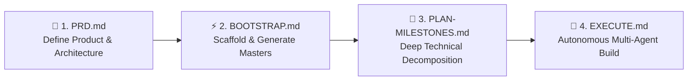
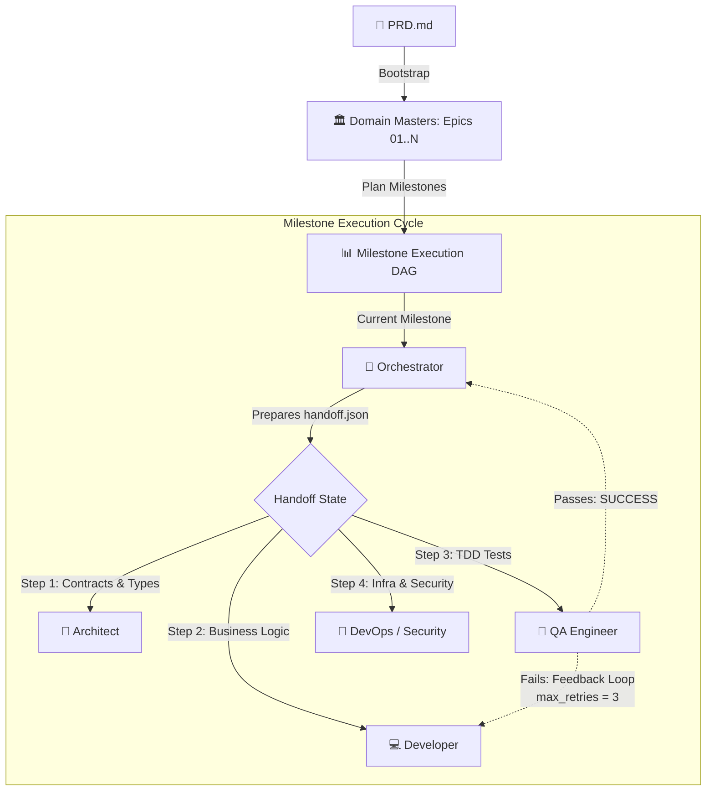

# 🤖 Universal MultiAgent-Kit (v6.1 Production-Ready)

[]()
[]()
[]()
[]()

A battle-tested, language-agnostic multi-agent engineering framework designed to transform any AI CLI or IDE assistant (such as Google Antigravity, Claude Code, Cursor Composer, or terminal LLM agents) into a disciplined, high-velocity autonomous software engineering team.

MultiAgent-Kit v6.1 eliminates the core failure modes of autonomous coding agents—hallucinations, context window overflow, cosmetic test tampering, and infinite debugging loops—through a deterministic **PRD-Driven Lifecycle**, **Strict Single Responsibility Principle (SRP)**, a **Go-Native Typed Handoff Protocol**, and a catalog of **High-Leverage Professional Engineering Skills** that provide actionable algorithms without bloat.

---

## 🧭 The End-to-End 4-Step Lifecycle



1. **Step 1: Requirements in `PRD.md`**  
   Capture the product vision, preferred tech stack, architecture guidelines, and feature domains in the root `PRD.md` specification file.
2. **Step 2: Workspace Bootstrap & Master Generation (`BOOTSTRAP.md`)**  
   Run `Read BOOTSTRAP.md and follow it exactly.` The agent ingests `PRD.md`, scouts the repository, generates `agent/info/PROJECT_MAP.md`, and creates **Domain Masters (`agent/masters/NN-*.md`) with ZERO limits on quantity**.
3. **Step 3: Deep Technical Milestone Decomposition (`PLAN-MILESTONES.md`)**  
   Run `Read AGENTS.md, then read agent/tools/PLAN-MILESTONES.md and follow it exactly.` The Architect decomposes every Master into multiple granular, independently testable Milestones (`agent/Milestones/NN-MM-*.md`) with exhaustive technical contracts, negative scenarios, edge cases, and TDD matrices. **There is NO limit on the number of milestones.**
4. **Step 4: Autonomous Product Development (`EXECUTE.md`)**  
   Run `Read AGENTS.md, then agent/masters/EXECUTE.md and follow it exactly. MODE: FULLY AUTONOMOUS MULTI-AGENT EXECUTION.` The Orchestrator supervises worker roles or subagents, executing code, writing tests, verifying baselines, and committing atomically until the entire product is built.

---

## 🧠 High-Leverage Professional Skills Catalog

In MultiAgent-Kit, skills are **NOT** decorative fluff or platitudes that fill up context. Each skill equips the agent with concrete mental models, actionable algorithms, shell recipes, edge-case tables, and anti-patterns. Always-active skills are kept ultra-compact (<35 lines) to protect your context budget:

| Skill | Type | Trigger / When to Use | Actionable Capability Added to Agent |
|---|---|---|---|
| [`token-budget`](file:///media/amin/Amin/code/MultiAgent-Kit/agent/skills/always/token-budget/SKILL.md) | `always` | Every turn (automatic) | Grep-first AST lookups, bounded line slicing (`sed -n`), deterministic CLI truncation. |
| [`self-review`](file:///media/amin/Amin/code/MultiAgent-Kit/agent/skills/always/self-review/SKILL.md) | `always` | Before turn completion | Pre-commit sanity gate: diff audit, regex secret scanner, test regression check. |
| [`checkpointing`](file:///media/amin/Amin/code/MultiAgent-Kit/agent/skills/always/checkpointing/SKILL.md) | `always` | State transitions | Atomic step commits, typed state persistence, and instant crash recovery. |
| [`handoff-sync`](file:///media/amin/Amin/code/MultiAgent-Kit/agent/skills/always/handoff-sync/SKILL.md) | `always` | Inter-agent delegation | Typed JSON contract alignment, state machine validation, anti-loop circuit breaker. |
| [`debugging`](file:///media/amin/Amin/code/MultiAgent-Kit/agent/skills/on-demand/debugging/SKILL.md) | `on-demand` | Test failures & runtime bugs | Scientific 5-phase Delta Debugging, minimal repro harness, and automated `git bisect`. |
| [`safe-refactor`](file:///media/amin/Amin/code/MultiAgent-Kit/agent/skills/on-demand/safe-refactor/SKILL.md) | `on-demand` | Internal restructuring | Martin Fowler's Parallel Change (Branch by Abstraction) with instant revert rule. |
| [`safe-db-migration`](file:///media/amin/Amin/code/MultiAgent-Kit/agent/skills/on-demand/safe-db-migration/SKILL.md) | `on-demand` | Schema & table changes | Zero-downtime Expand & Contract protocol, non-blocking DDL, and throttled backfills. |
| [`test-design`](file:///media/amin/Amin/code/MultiAgent-Kit/agent/skills/on-demand/test-design/SKILL.md) | `on-demand` | TDD planning & test suites | Boundary Value Analysis (-1, 0, +1, max, nil), fault injection, and race hazard tests. |
| [`security-review`](file:///media/amin/Amin/code/MultiAgent-Kit/agent/skills/on-demand/security-review/SKILL.md) | `on-demand` | Auth, crypto & public routes | STRIDE threat modeling, OWASP Top 10 static audit, SSRF defense, and secret scanner. |
| [`performance-investigation`](file:///media/amin/Amin/code/MultiAgent-Kit/agent/skills/on-demand/performance-investigation/SKILL.md) | `on-demand` | High latency / memory leaks | Quantitative profiling (pprof), `EXPLAIN ANALYZE` query plans, allocation benchmarking. |
| [`code-review`](file:///media/amin/Amin/code/MultiAgent-Kit/agent/skills/on-demand/code-review/SKILL.md) | `on-demand` | Peer review & pre-merge | Staff+ 5-dimension review framework with structured blocking vs non-blocking triage. |
| [`api-contract-check`](file:///media/amin/Amin/code/MultiAgent-Kit/agent/skills/on-demand/api-contract-check/SKILL.md) | `on-demand` | API, Protobuf & DTO updates | Additive backward compatibility rules, Protobuf `reserved` tags, and REST semantics. |
| [`dependency-upgrade`](file:///media/amin/Amin/code/MultiAgent-Kit/agent/skills/on-demand/dependency-upgrade/SKILL.md) | `on-demand` | Package bumps & CVE fixes | Automated CVE auditing (`govulncheck`), lockfile diff scrutiny, and license checks. |
| [`docs-writer`](file:///media/amin/Amin/code/MultiAgent-Kit/agent/skills/on-demand/docs-writer/SKILL.md) | `on-demand` | Documentation sync | Zero-drift extraction directly from verified code, ADR tables, and OpenAPI sync. |
| [`release-checklist`](file:///media/amin/Amin/code/MultiAgent-Kit/agent/skills/on-demand/release-checklist/SKILL.md) | `on-demand` | Pre-flight release | Clean container build, SemVer audit, graceful shutdown (`SIGTERM`), and rollback plan. |

---

## 🏗️ Multi-Agent Execution Flow



---

## 📂 Directory Layout

```text
.
├── AGENTS.md                 # System entry point for all agents
├── BOOTSTRAP.md              # Workspace initializer & Master generator (PRD-driven)
├── PRD.md                    # Product Requirements Document (idea & specifications)
├── Makefile                  # Build, test, validate, summary, stats targets
└── agent/
    ├── HANDOFF_SCHEMA.md     # Strict JSON schema for agent communication
    ├── KIT.md                # Kit v6.1 architectural specification
    ├── MULTI_AGENT_COMMANDS.md# Copy-paste terminal commands for all workflows
    ├── RUNBOOK.md            # Operator manual & system management guide
    ├── STATE.md              # Global execution state & quick tasks log
    ├── .state/
    │   └── handoff.json      # Single source of truth for agent transitions
    ├── rules/                # Non-negotiable engineering rules (00 to 10)
    ├── roles/                # Isolated agent personas (Orchestrator, Dev, QA, etc.)
    ├── skills/               # 15 high-leverage engineering procedures (always & on-demand)
    ├── masters/              # Domain-driven epic architectural blueprints (01-*.md)
    ├── Milestones/           # Granular, actionable milestone files (NN-MM-*.md) & INDEX
    └── tools/
        ├── mak               # Compiled Go-native CLI & validator binary
        ├── validate_state    # Symlink / binary alias for backward compatibility
        ├── PLAN-MILESTONES.md# Deep technical milestone decomposition engine
        ├── NEW-FEATURE.md    # Post-bootstrap domain feature planner
        ├── QUICK-TASK.md     # Micro-fixes & hotfix protocol (< 3 files)
        └── validator/        # Go source code & unit tests (main.go, main_test.go)
```

---

## 🚀 Quick Start Guide

### 1. Define Your Idea in `PRD.md`
Fill in `PRD.md` at your repository root with your product idea, tech stack preferences, and feature domains (or run `./agent/tools/mak init-prd` to create a template).

### 2. Bootstrap Workspace & Generate Masters
In your AI assistant terminal or chat, run:
```bash
Read BOOTSTRAP.md and follow it exactly.
```
*Output: Scaffolds the workspace, maps the project, and generates Domain Masters (`agent/masters/01-*.md`, etc.) for every feature domain in your PRD.*

### 3. Decompose Masters into Granular Milestones
Run:
```bash
Read AGENTS.md, then read agent/tools/PLAN-MILESTONES.md and follow it exactly.
```
*Output: Decomposes each Master into granular, production-ready Milestones (`agent/Milestones/NN-MM-*.md`) with deep technical contracts, negative scenarios, and TDD verification matrices.*

### 4. Start Autonomous Product Development
Run:
```bash
Read AGENTS.md, then agent/masters/EXECUTE.md and follow it exactly.
MODE: FULLY AUTONOMOUS MULTI-AGENT EXECUTION.
```
*Output: The Orchestrator autonomously dispatches workers/subagents through the Supervisor-Worker cycle until the entire product is implemented, tested, and committed.*

---

## 🛠️ Go-Native CLI Reference (`agent/tools/mak`)

MultiAgent-Kit features a unified, zero-dependency Go CLI tool:

```bash
# Fast state validation (handoff.json & STATE.md)
./agent/tools/mak validate

# Full system integrity audit (rules, roles, skills, templates, PRD, state)
./agent/tools/mak check-all

# Visual execution dashboard
./agent/tools/mak summary

# Milestone execution metrics & progress bar
./agent/tools/mak stats

# Synchronize timestamps in state files
./agent/tools/mak touch

# Safely reset QA retry counter and unblock
./agent/tools/mak reset-retry

# Initialize default PRD.md template
./agent/tools/mak init-prd

# Run via Make:
make stats
make summary
make validate-all
make reset-retry
```

---

## 🛡️ Core Safety Principles

- The `agent/` directory is isolated engineering tooling and must **NEVER** be imported into production application bundles or Docker runtime images.
- Destructive commands (`rm -rf`, `DROP TABLE`, `git push --force`) are strictly prohibited autonomously and require human authorization.
- Zero secrets leakage: API keys, tokens, and passwords must never be committed; use `.env.example` placeholders.
- Non-regression guarantee: Passed test count must always be $\ge$ baseline count with 0 new failures.

---
*MultiAgent-Kit v6.1 — Engineered for deterministic, reliable, and autonomous AI software engineering.*
